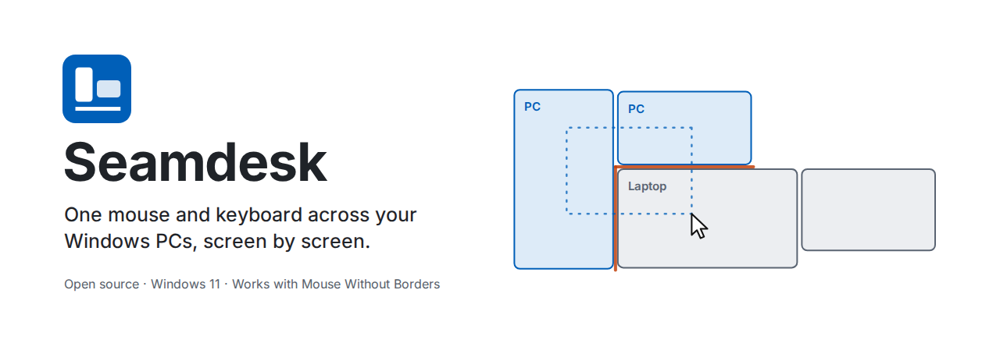
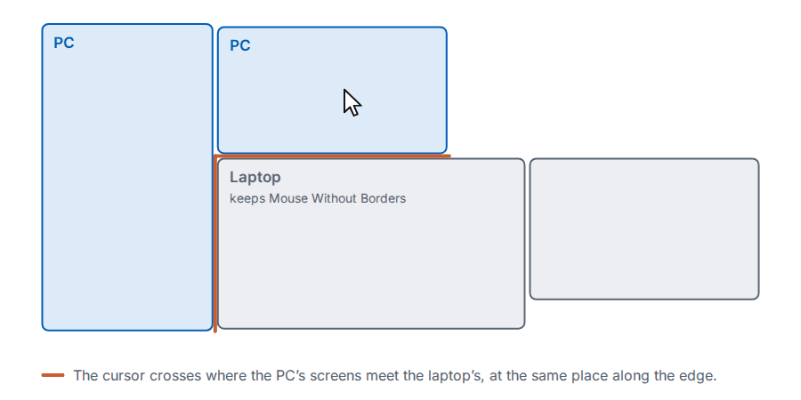
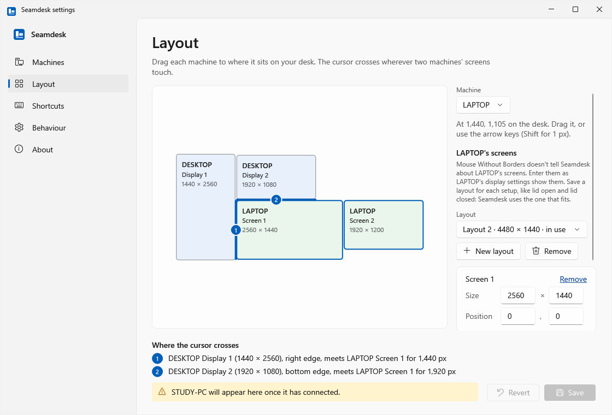
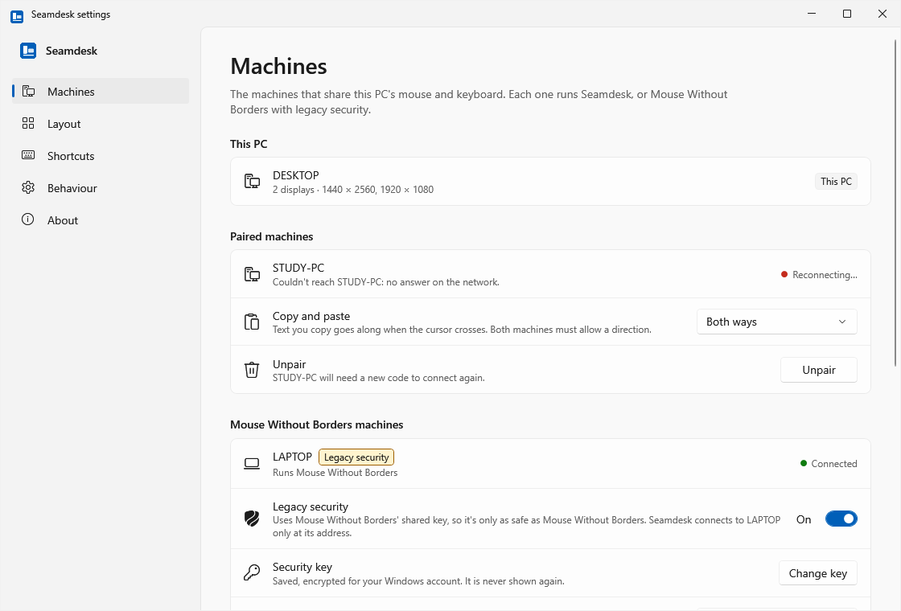
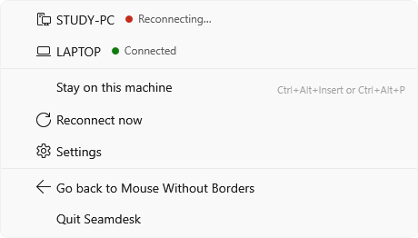

<p align="center">
  <picture>
    <source media="(prefers-color-scheme: dark)" srcset="docs/images/hero-dark.png">
    
  </picture>
</p>

# Seamdesk

Seamdesk shares one mouse and keyboard between Windows 11 PCs, screen by screen. If you already use Microsoft's Mouse
Without Borders at work, it fixes the everyday annoyances, and it can keep working with a laptop that stays on Mouse
Without Borders.

Seamdesk is free and open source under the MIT licence. It's an independent project, not affiliated with or endorsed by
Microsoft.

## Why

Mouse Without Borders (MWB) comes from Microsoft, so it's often the tool that's allowed at work. If you've used it for a
while, you probably know these:

- **The cursor only crosses where the machines' outlines meet.** MWB treats each PC as one rectangle in a grid, so a
  portrait monitor, screens of different heights or a laptop below a monitor leave edges where the cursor gets stuck.
  Seamdesk puts every monitor of every machine on one desk, and the cursor crosses wherever two screens actually touch.
- **The cursor jumps when it crosses.** Seamdesk keeps its place along the edge, to the pixel, so it comes out where
  you'd expect.
- **The pointer speed changes from one machine to the next.** Seamdesk moves the pointer 1:1 in pixels on every screen,
  after your own mouse settings, without a second round of acceleration on the other side.
- **It stops reconnecting after sleep or lock** until you click refresh. Seamdesk keeps retrying every machine on its
  own, and straight away after resume, unlock or a network change.
- **It lags with a fast mouse.** Seamdesk adds up the moves of a 1,000 Hz or 8 kHz mouse and sends them together, so
  the link doesn't flood.
- **The cursor goes missing, or keys stay held down.** When the cursor comes back it shows up at the edge it crossed,
  and leaving a machine lets go of every key and button you were holding there.

<p align="center">
  <picture>
    <source media="(prefers-color-scheme: dark)" srcset="docs/images/crossing-dark.gif">
    
  </picture>
</p>

You don't have to switch everything at once. Seamdesk on your PC can drive a laptop that keeps running Mouse Without
Borders, with the same security key and the same layout. Nothing changes on the laptop.

## Screenshots

<p align="center">
  
</p>

| Machines | Tray menu |
|---|---|
|  |  |

Every window in light and dark, at 100 % and 150 %, is in [docs/screenshots](docs/screenshots).

## What it doesn't do

- **Windows 11 only.** It needs TLS 1.3 in Windows' own TLS stack. No Windows 10, macOS or Linux: if you need those,
  look at Deskflow or Lan Mouse.
- **No lock screen, UAC prompt or Ctrl+Alt+Del** on the other machine, and no typing into windows running as
  administrator. Mouse Without Borders can do these; Seamdesk runs as you, without admin rights.
- **Text only on the clipboard.** No images or files, no file transfer, and no dragging windows between machines.
- **Tested with two machines.** More should work, but hasn't been tried.
- **Early days on real hardware.** Seamdesk drives a laptop on standalone Mouse Without Borders 2.2.1 day to day. Two
  Seamdesk PCs end to end, switching on lock and sleep, and PowerToys MWB peers are covered by tests but haven't run on
  real machines yet.
- **Releases aren't code-signed yet.** See the FAQ.

## Install

Per user, no admin rights, and no .NET to install.

1. Download `Seamdesk-<version>-win-x64.zip` and its `.sha256` file from the [releases](../../releases).
2. Check the download. In PowerShell, `(Get-FileHash .\Seamdesk-<version>-win-x64.zip).Hash` must match the hash in the
   `.sha256` file.
3. Unzip it, open PowerShell in the unzipped folder, and run:

   ```powershell
   powershell -ExecutionPolicy Bypass -File install.ps1
   ```

Seamdesk installs to `%LOCALAPPDATA%\Programs\Seamdesk`, adds a Start menu shortcut, starts when you sign in, and turns
off Mouse Without Borders' autostart on this PC where it can, writing down exactly what it changed. Running it again
upgrades in place; your settings and keys stay.

- **SmartScreen** may say "Windows protected your PC", because the release isn't signed. Choose **More info**, then
  **Run anyway**, once you've checked the hash.
- **Windows Firewall** may ask once. Allow **private networks** only.
- **Going back:** the tray menu's **Go back to Mouse Without Borders** quits Seamdesk, starts MWB and puts its
  autostart back. To remove Seamdesk, run `uninstall.ps1` in `%LOCALAPPDATA%\Programs\Seamdesk`; it also puts MWB's
  autostart back, and keeps your settings unless you ask.

More detail, including exactly what the installer touches, is in [docs/release.md](docs/release.md).

## First run

Seamdesk lives in the tray (the notification area, maybe behind the **^** arrow). Click its icon to open the settings.

### With a laptop that keeps Mouse Without Borders

1. On **Machines**, next to **A machine running Mouse Without Borders**, choose **Add**. Type a name for the laptop, its
   computer name or IP address, and the security key from MWB's settings on the laptop. Seamdesk keeps the key
   encrypted for your Windows account and never shows it again.
2. On **Layout**, pick the laptop and enter its screen size (MWB doesn't tell Seamdesk about the laptop's screens). Drag
   it to where it sits, on the same side of the PC as in the laptop's MWB layout, and choose **Save**.
3. Within a few seconds the laptop's card says **Connected**. Move the cursor across.

The laptop keeps its key and layout; Seamdesk answers under this PC's computer name, as MWB did. The laptop can't
control this PC unless you turn on **Let … control this PC** on its card.

### Between two Seamdesk PCs

1. Install Seamdesk on both.
2. On the first PC, under **Machines**, next to **A machine running Seamdesk**, choose **Show a code**.
3. On the second, choose **Enter a code** and type the first PC's name or IP address and the 8-digit code. The code
   works once, for 2 minutes, with 3 tries.
4. On **Layout**, drag each machine's screens to where they sit, and choose **Save**.

### Shortcuts

- **Ctrl+Alt+Home** (or **Ctrl+Alt+H**) brings the cursor back to this PC.
- **Ctrl+Alt+Insert** (or **Ctrl+Alt+P**) keeps it on this PC until you press it again.

You can change both under **Shortcuts**.

## Mouse Without Borders compatibility

Seamdesk speaks Mouse Without Borders' protocol to the machines you add as MWB machines, and works out which version
each one runs.

| MWB on the other machine | Seamdesk drives it | It drives Seamdesk (opt-in) | Copy and paste (text) | How it's checked |
|---|---|---|---|---|
| Standalone MWB 2.2.1 ("Microsoft Garage") | Yes | Yes | Either way, per machine | Driving a laptop day to day; the other direction not yet on real hardware |
| PowerToys MWB up to 0.100 | Yes | Yes | Either way, per machine | Against MWB's own code, both ways; not yet with a real machine |
| PowerToys MWB 0.101 and later | Yes | Yes | Either way, per machine | Against MWB's own code, both ways; not yet with a real machine |

> [!WARNING]
> A link to an MWB machine uses **legacy security**: MWB's single shared key, as MWB itself does. It's no weaker than
> MWB, and no stronger: anyone with the key, or who can guess a weak one, can read and type on that link. It's off by
> default and set per machine. Seamdesk talks to that machine only at the address you typed, and the machine can't
> control yours unless you allow it. Between two Seamdesk PCs none of this applies (see below).

## Security

Between Seamdesk PCs, each install has its own key. You pair two machines once with a one-time 8-digit code; after that
they only talk over TLS 1.3, each checking the other's pinned key. Seamdesk listens only to private network addresses,
needs no admin rights, sends no discovery broadcasts and talks to nothing outside your network.

- How it works, what it doesn't protect against and its known limits: [docs/security.md](docs/security.md).
- Found a vulnerability? Please report it privately, as described in [SECURITY.md](SECURITY.md).

## FAQ

**Is this a Microsoft product?**
No. Seamdesk is independent and isn't affiliated with or endorsed by Microsoft. It can talk to Mouse Without Borders,
which is part of Microsoft PowerToys; a small part of its MWB code is ported from PowerToys (MIT licence, see
[THIRD-PARTY-NOTICES.txt](THIRD-PARTY-NOTICES.txt)).

**Can I use it at work?**
Only if your organisation allows it. Seamdesk installs without admin rights, but that doesn't make it approved. A
laptop that keeps Mouse Without Borders needs nothing installed, but connecting it to a PC running Seamdesk is still
yours to clear with whoever manages that laptop.

**Why does my antivirus complain?**
A keyboard hook, input injection and an autostart entry in an unsigned program look like a keylogger to some
heuristics. Check the hash, or build it yourself from this repo. If your antivirus flags it, please report a false
positive to the vendor (for Microsoft Defender: https://www.microsoft.com/wdsi/filesubmission).

**Why isn't it signed?**
Code signing isn't set up yet. Until it is, every release publishes its SHA-256 next to the download.

**Why Windows 11 only?**
Seamdesk uses TLS 1.3 through Windows' own TLS stack, which Windows 10 doesn't offer.

**Does it work with Input Leap, Barrier, Deskflow or Synergy?**
No. They use their own protocols. Seamdesk speaks its own and Mouse Without Borders'.

**Where's the log?**
`%LOCALAPPDATA%\Seamdesk\seamdesk.log`. It holds machine names, addresses and link events, never keys, keystrokes or
clipboard text. Remove names and addresses before you share it.

## Building from source

With the .NET 10 SDK, on Windows or Linux:

```sh
dotnet test Seamdesk.slnx
```

The Windows app and its tests build on Windows; the core, transport, host and MWB code and their tests run anywhere.
[CONTRIBUTING.md](CONTRIBUTING.md) has the layout of the code, how to run the Windows checks and how to cut a release.
Design decisions are in [docs/design.md](docs/design.md).

## Licence

MIT, see [LICENSE](LICENSE). Portions are derived from Mouse Without Borders in Microsoft PowerToys, also MIT; their
notices are in [THIRD-PARTY-NOTICES.txt](THIRD-PARTY-NOTICES.txt). Mouse Without Borders and PowerToys are Microsoft
products.
